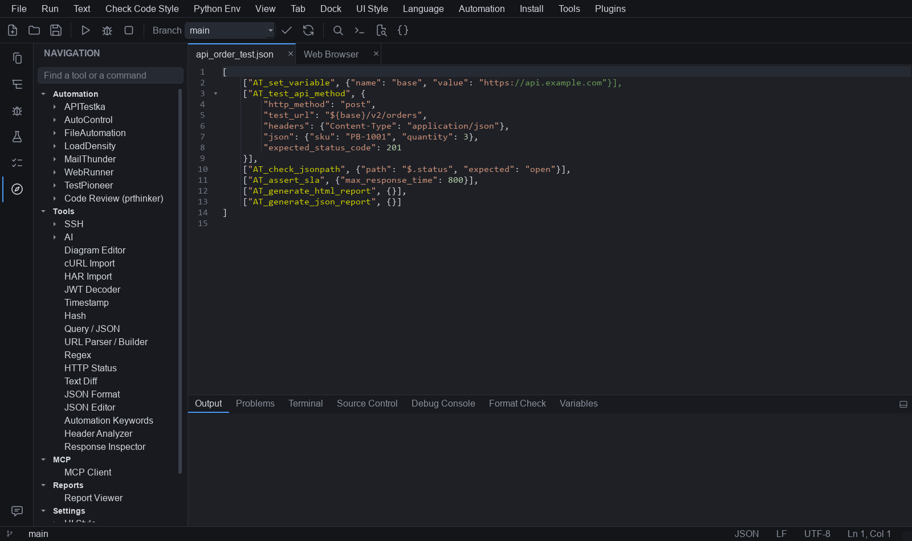
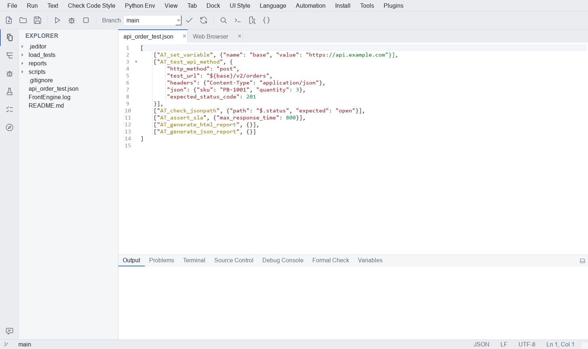

UI Overview
===========

PyBreeze's window is JEditor's: an activity bar at the left edge, a side bar beside it,
the editor tabs in the middle, a panel below them and a secondary side bar at the right,
built on PySide6 (Qt for Python). The picture shows it in the default theme, JEditor Dark,
with the Navigation view in the side bar.

The same window in JEditor Light, with the Explorer in the side bar.

.. note::

   This page describes the window with a JEditor that has the shell (the activity bar and
   the side bar). With an earlier JEditor, 1.0.27 for instance, each editor tab carries
   its own file tree and output panel, the navigation is a dock at the left that
   **Dock > Navigation** shows and hides, and the default theme is ``dark_amber.xml``.

Main Window Layout
------------------

Menu Bar
^^^^^^^^

The menu bar holds these top-level menus, from left to right:

- **File** -- new, open and save files, open a folder, recent files, font, encoding and
  line endings (see :doc:`menu_file_run_text`)
- **Run** -- run the current file with Python, or its text as a shell command, the debugger,
  stop a run;
  **Run with...** when a plugin has registered a run configuration
- **Text** -- font, word wrap, indentation and text transformations
- **Check Code Style** -- ``yapf``, JSON reformatting, the Python format check and format
  on save
- **Python Env** -- create a virtual environment, ``pip``, and choose the interpreter runs
  use
- **Tab** -- open editor, browser, console, Git and tool tabs (JupyterLab is under
  **Tools Tab**, see :doc:`jupyter_lab`)
- **Dock** -- open the same kinds of panels, and PyBreeze's tools, as docks
- **UI Style** -- the theme, indent guides, trailing whitespace and keyboard shortcuts
- **Language** -- the interface language
- **Automation** -- the automation modules (see :doc:`menu_automation`)
- **Install** -- install automation packages and build tools (see :doc:`menu_install`)
- **Tools** -- the SSH client, AI tools, diagram editor, HTTP / API utilities, JSON
  editor, automation keywords, MCP client and report viewer (see :doc:`menu_tools`)
- **Plugins** -- the Plugin Browser and the loaded plugins (see :doc:`menu_plugins`)

Activity Bar and Side Bar
^^^^^^^^^^^^^^^^^^^^^^^^^

The icons at the left edge switch the side bar between its views: **Explorer** (the file
tree), **Outline**, **Run and Debug**, **Testing**, **TODO** and PyBreeze's **Navigation**.
Clicking the icon of the view that is shown hides the side bar; **View > Toggle Side Bar**
does the same. The view left open, and whether the side bar is open at all, is remembered
with the project.

Navigation Panel
^^^^^^^^^^^^^^^^

A view of the side bar, with the compass icon in the activity bar, lists what the menus
hold in five categories: **Automation**, **Tools**, **MCP**, **Reports** and **Settings**.
Typing in its box keeps the lines that hold the text; Enter or a double click on a line
does what the menu entry does. It is the view shown on a first start, and
**View > Navigation** switches to it.

File Tree
^^^^^^^^^

The **Explorer** view of the side bar: one tree for the whole window, whichever tab is in
front. You can:

- Browse files and folders
- Click a file to open it in a tab of its own; a blank, untouched tab is used instead of
  opening another, and a file already open in a tab switches to that tab
- Right-click any file or folder to access the context menu (see below)
- Press **F2** to rename, or **Delete** to delete, the item in focus while the tree has
  the focus

File Tree Context Menu
""""""""""""""""""""""

Right-clicking the file tree opens a context menu with the following actions:

.. list-table::
   :header-rows: 1
   :widths: 25 75

   * - Action
     - Description
   * - **New File**
     - Prompts for a name and creates an empty file in the clicked directory
       (or the directory containing the clicked file). A name with a drive, a leading
       slash, ``..`` or ``:`` is refused, and so is one that already exists.
   * - **New Folder**
     - Prompts for a name and creates a new directory, with the same checks.
   * - **Rename**
     - Renames the selected file or folder. Editor tabs open on it, or on a file inside
       the folder, follow it to the new name.
   * - **Delete**
     - Asks first, with **No** as the default, then moves the item to the trash (the
       Recycle Bin on Windows). Where there is no trash, as on some network drives, it
       asks again before deleting for good. A link is removed itself, not what it points
       to. Editor tabs whose file is gone are closed.
   * - **Copy Path**
     - Copies the absolute path of the selected item to the clipboard.
   * - **Copy Relative Path**
     - Copies the path relative to the file tree's root directory.
   * - **Reveal in File Explorer**
     - Shows the item in the platform file manager: selected in Explorer on Windows and
       in Finder on macOS; on Linux, ``xdg-open`` opens its folder.

Code Editor (Tab Widget)
^^^^^^^^^^^^^^^^^^^^^^^^^

The central area uses a tabbed interface. Each opened file gets its own tab.
Additional tool tabs (SSH, AI, JupyterLab, the diagram editor, the HTTP / API utilities,
automation GUIs) can also be opened here.

Features:

- Syntax highlighting for Python and for the languages JEditor colours (C, C++, Go, Java,
  JavaScript, JSON, Rust, shell, SQL, TOML, TypeScript, YAML and more). PyBreeze registers
  its automation keywords for ``.json``, ``.yml`` and ``.yaml``, but JEditor highlights
  those files with its own rules, which leave registered keywords out.
- Multiple file editing with tabs
- Extendable with custom tabs via ``EDITOR_EXTEND_TAB`` (see :doc:`how_to_extend_ui`)
- A tool tab with unsaved work (a prompt editor, the diagram editor) asks before it
  closes, and so does closing the IDE

Bottom Panel
^^^^^^^^^^^^

The panel below the editor tabs belongs to the window, not to a tab, and holds **Output**,
**Problems**, **Terminal**, **Source Control**, **Debug Console**, **Format Check** and
**Variables**:

- **Output** shows the output of **Run Program** and **Run On Shell**, errors in the
  theme's error colour, and the IDE's log messages (warnings and errors only);
- **Problems** lists what ``ruff`` and the language servers found;
- **Source Control** is the Git client;
- **Format Check** lists what **Check Code Style > Python format check** found;
- **Debug Console** is where the debugger writes.

**View > Toggle Panel** shows and hides it, as does the button at its right end. The AI
chat opens in the secondary side bar at the right (**View > Toggle Secondary Side Bar**).

Run Window
^^^^^^^^^^

An automation script, a batch of them, a package install or a **Run with...** run each
opens a window of its own for its output. This window:

- Is titled with what it runs (the package and the file, for instance)
- Shows the output as it arrives, errors in the error colour, in a fixed-pitch font, and
  keeps the last 10,000 lines
- Has a **Stop** button, enabled while the run goes on
- Asks, when closed while the run goes on, whether to stop it: **Yes** stops it, **No** lets it
  run on without a window (closing the IDE still stops it), **Cancel** keeps the window open
- Sizes itself to a third of the screen

Dock Widgets
^^^^^^^^^^^^

Panels can be opened as **dock widgets** instead of tabs from the **Dock** menu, and
arranged freely around the main window:

- **Editor** -- a docked editor, IPython (Jupyter) and the variable inspector (empty for now,
  see :doc:`menu_file_run_text`)
- **Git** -- the Git client, branch tree viewer and code diff viewer
- **AI** -- Chat UI, AI Code Review, CoT Prompt Editor, CoT Code Review, Skill Prompt
  Editor and Skill Send
- **Tools** -- a browser, FrontEngine, the console, the TODO panel, Problems, Tests and
  the outline
- **SSH** -- the SSH client
- the diagram editor and each HTTP / API utility, at the menu's top level

Dock widgets can be dragged, resized, floated, stacked and snapped to any edge of the
main window.

Theme System
------------

The **UI Style** menu lists JEditor's two themes first, then those of
`qt_material <https://github.com/UN-GCPDS/qt-material>`_:

- ``jeditor_dark`` -- **JEditor Dark** (default)
- ``jeditor_light`` -- **JEditor Light**
- ``dark_amber.xml``
- ``dark_blue.xml``
- ``dark_cyan.xml``
- ``dark_lightgreen.xml``
- ``dark_pink.xml``
- ``dark_purple.xml``
- ``dark_red.xml``
- ``dark_teal.xml``
- ``dark_yellow.xml``
- ``light_amber.xml``
- ``light_blue.xml``
- ``light_cyan.xml``
- ``light_cyan_500.xml``
- ``light_lightgreen.xml``
- ``light_pink.xml``
- ``light_purple.xml``

Clicking one applies it to the whole application. The theme can also be set at launch
time:

.. code-block:: python

   from pybreeze import start_editor

   start_editor(theme="jeditor_light")

The theme picked from **UI Style** is saved and used at the next start. A theme given to
``start_editor`` replaces it, and is saved in its place.

Multi-Language Support
----------------------

The **Language** menu offers:

- **English** (default)
- **繁體中文** (Traditional Chinese)
- **日本語** (Japanese) and **简体中文** (Simplified Chinese), which are JEditor's: picked,
  JEditor's own menus change and PyBreeze's strings stay in English
- languages added by translation plugins (see :doc:`menu_plugins`)

Menus, dialogs, the reasons a tool refuses its input and the run window's own notices
follow the chosen language.
