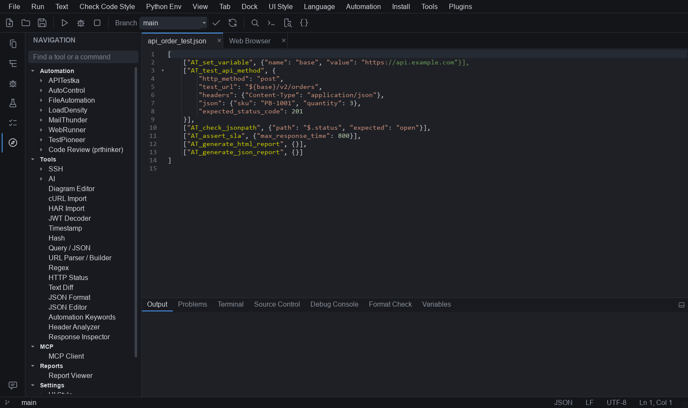
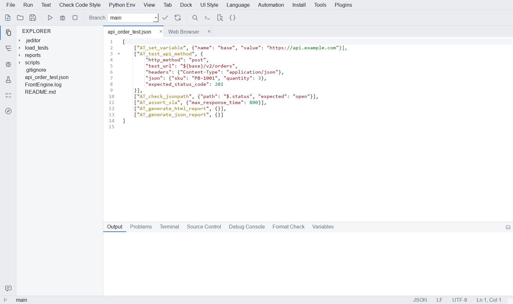

UI 總覽
=======

PyBreeze 的視窗就是 JEditor 的視窗：最左邊是活動列，旁邊是側邊欄，中間是編輯分頁，下方是面板，
右邊是第二側邊欄，以 PySide6（Qt for Python）建構。上圖是預設主題 JEditor Dark，側邊欄顯示導覽面板。

同一個視窗在 JEditor Light 主題下，側邊欄顯示檔案總管。

.. note::

   本頁說明的是搭配有外框（活動列與側邊欄）的 JEditor 時的視窗。搭配較早的 JEditor（例如 1.0.27）時，
   每個編輯分頁各有自己的檔案樹與輸出面板，導覽面板是左側的停靠面板，由 **Dock > Navigation** 顯示或隱藏，
   預設主題是 ``dark_amber.xml``。

本指南的選單與按鈕名稱以英文介面為準。在 **Language** 選單選「繁體中文」後，介面會顯示對應的中文名稱，
例如 **Tools** 是「工具」、**Dock** 是「區域」、**Automation** 是「自動化」。

主視窗佈局
----------

選單列
^^^^^^

選單列包含以下頂層選單（由左至右）：

- **File** -- 新增、開啟與儲存檔案，開啟資料夾、最近的檔案、字型、編碼與行尾（見 :doc:`menu_file_run_text`）
- **Run** -- 以 Python 執行目前的檔案，或把它的文字當成 Shell 指令執行、除錯器、停止執行；有外掛註冊執行設定時另有 **Run with...**
- **Text** -- 字型、自動換行、縮排與文字轉換
- **Check Code Style** -- ``yapf``、JSON 重新排版、Python 格式檢查與存檔時自動格式化
- **Python Env** -- 建立虛擬環境、``pip``，以及選擇執行時使用的直譯器
- **Tab** -- 開啟編輯器、瀏覽器、主控台、Git 與工具分頁（JupyterLab 在 **Tools Tab** 下，見 :doc:`jupyter_lab`）
- **Dock** -- 以停靠面板開啟同類的面板，以及 PyBreeze 的工具
- **UI Style** -- 主題、縮排參考線、行尾空白與鍵盤快捷鍵
- **Language** -- 介面語言
- **Automation** -- 自動化模組（見 :doc:`menu_automation`）
- **Install** -- 安裝自動化套件與建置工具（見 :doc:`menu_install`）
- **Tools** -- SSH 用戶端、AI 工具、架構圖編輯器、HTTP / API 小工具、JSON 編輯器、自動化關鍵字、
  MCP 用戶端與報告檢視器（見 :doc:`menu_tools`）
- **Plugins** -- 外掛瀏覽器與已載入的外掛（見 :doc:`menu_plugins`）

活動列與側邊欄
^^^^^^^^^^^^^^

視窗最左邊的圖示讓側邊欄在各個面板之間切換： **Explorer** （檔案樹）、 **Outline**、
**Run and Debug**、 **Testing**、 **TODO**，以及 PyBreeze 的 **Navigation**。點目前顯示的面板的圖示
會收起側邊欄， **View > Toggle Side Bar** 也一樣。離開時開著哪個面板、側邊欄是否開著，會跟著專案記住。

導覽面板
^^^^^^^^

側邊欄的一個面板，在活動列上是指南針圖示，把各選單的內容分成五類列出： **Automation**、 **Tools**、
**MCP**、 **Reports** 與 **Settings**。在它的輸入框打字會留下含有那段文字的項目；在某一行按 Enter
或按兩下，效果和選單項目相同。第一次啟動時顯示的就是它， **View > Navigation** 可以切換到它。

檔案樹
^^^^^^

側邊欄的 **Explorer** 面板：整個視窗共用一棵樹，不論前景是哪個分頁。您可以：

- 瀏覽檔案和資料夾
- 單擊檔案會把它開在自己的分頁；空白且沒改過的分頁會直接拿來用，已在某個分頁開啟的檔案則會切換到那個分頁
- 右鍵任何檔案或資料夾以開啟功能選單（詳見下方）
- 檔案樹有焦點時，按 **F2** 重新命名、按 **Delete** 刪除焦點所在的項目

檔案樹右鍵選單
""""""""""""""

在檔案樹中按右鍵會跳出包含以下動作的選單：

.. list-table::
   :header-rows: 1
   :widths: 25 75

   * - 動作
     - 說明
   * - **New File**
     - 跳出輸入框詢問檔名，在按右鍵的目錄下（或被點擊檔案所在目錄）建立空檔案。
       含磁碟機代號、開頭斜線、``..`` 或 ``:`` 的名稱會被拒絕，已存在的名稱也是。
   * - **New Folder**
     - 跳出輸入框詢問資料夾名稱，建立新目錄，檢查方式相同。
   * - **Rename**
     - 重新命名選取的檔案或資料夾。開在這個檔案、或資料夾內檔案上的編輯器分頁會跟著改到新名稱。
   * - **Delete**
     - 先詢問（預設為 **No**），再把項目移到垃圾桶（Windows 的資源回收筒）。沒有垃圾桶的地方
       （例如某些網路磁碟）會再問一次，才永久刪除。連結只刪除連結本身，不動它指向的東西。
       檔案已不存在的編輯器分頁會關閉。
   * - **Copy Path**
     - 將選取項目的絕對路徑複製到剪貼簿。
   * - **Copy Relative Path**
     - 複製相對於檔案樹根目錄的路徑。
   * - **Reveal in File Explorer**
     - 在作業系統的檔案管理員中顯示這個項目：Windows 的檔案總管與 macOS 的 Finder 會選取它；
       Linux 則以 ``xdg-open`` 開啟它所在的資料夾。

程式碼編輯器（分頁元件）
^^^^^^^^^^^^^^^^^^^^^^^^

中央區域使用分頁介面，每個開啟的檔案都有自己的分頁。其他工具分頁（SSH、AI、JupyterLab、
架構圖編輯器、HTTP / API 小工具、自動化 GUI）也可以在這裡開啟。

功能：

- Python 與 JEditor 會上色的語言（C、C++、Go、Java、JavaScript、JSON、Rust、Shell、SQL、TOML、
  TypeScript、YAML 等）的語法高亮。PyBreeze 為 ``.json``、``.yml``、``.yaml`` 註冊了自動化關鍵字，
  但 JEditor 用自己的規則為這些檔案上色，不包含註冊的關鍵字。
- 多分頁編輯多個檔案
- 可透過 ``EDITOR_EXTEND_TAB`` 擴充自訂分頁（見 :doc:`how_to_extend_ui`）
- 有未儲存內容的工具分頁（提示詞編輯器、架構圖編輯器）關閉前會先詢問，關閉 IDE 時也是

下方面板
^^^^^^^^

編輯分頁下方的面板屬於視窗，而不是某個分頁，包含 **Output**、 **Problems**、 **Terminal**、
**Source Control**、 **Debug Console**、 **Format Check** 與 **Variables**：

- **Output** 顯示 **Run Program** 與 **Run On Shell** 的輸出，錯誤以主題的錯誤色呈現，
  也會顯示 IDE 的日誌訊息（只有警告與錯誤）；
- **Problems** 列出 ``ruff`` 與語言伺服器找到的問題；
- **Source Control** 是 Git 用戶端；
- **Format Check** 列出 **Check Code Style > Python format check** 找到的問題；
- **Debug Console** 是除錯器輸出的地方。

**View > Toggle Panel** 可以顯示或隱藏它，面板右端的按鈕也可以。AI 聊天開在右邊的第二側邊欄
（ **View > Toggle Secondary Side Bar** ）。

執行視窗
^^^^^^^^

自動化腳本、一批腳本、套件安裝或 **Run with...** 的每一次執行，都會開一個自己的視窗顯示輸出。這個視窗：

- 標題說明它執行的東西（例如套件與檔案）
- 輸出一到就顯示，錯誤以錯誤色、等寬字型呈現，並保留最後 10,000 行
- 有 **Stop** 按鈕，執行期間可以按
- 執行中關閉視窗時會先問要不要停止：**Yes**\ 停止執行，**No**\ 讓它在沒有視窗的情況下繼續（關閉 IDE 時仍會停止），
  **Cancel**\ 保留視窗
- 大小為螢幕的三分之一

停靠面板
^^^^^^^^

面板可以從 **Dock** 選單以 **停靠面板** 開啟，而不是分頁，並可在主視窗周圍自由排列：

- **Editor** -- 停靠式編輯器、IPython（Jupyter）與變數檢視器（見 :doc:`menu_file_run_text`）
- **Git** -- Git 用戶端、分支樹檢視器與程式碼差異檢視器
- **AI** -- Chat UI、AI Code Review、CoT Prompt Editor、CoT Code Review、Skill Prompt Editor 與 Skill Send
- **Tools** -- 瀏覽器、FrontEngine、主控台、TODO 面板、Problems、Tests 與大綱
- **SSH** -- SSH 用戶端
- 架構圖編輯器與每個 HTTP / API 小工具，在選單的最上層

停靠面板可以拖曳、調整大小、浮動、堆疊，並停靠到主視窗的任何邊緣。

主題系統
--------

**UI Style** 選單先列出 JEditor 的兩個主題，接著是
`qt_material <https://github.com/UN-GCPDS/qt-material>`_ 的主題：

- ``jeditor_dark`` -- **JEditor Dark**\ （預設）
- ``jeditor_light`` -- **JEditor Light**
- ``dark_amber.xml``
- ``dark_blue.xml``
- ``dark_cyan.xml``
- ``dark_lightgreen.xml``
- ``dark_pink.xml``
- ``dark_purple.xml``
- ``dark_red.xml``
- ``dark_teal.xml``
- ``dark_yellow.xml``
- ``light_amber.xml``
- ``light_blue.xml``
- ``light_cyan.xml``
- ``light_cyan_500.xml``
- ``light_lightgreen.xml``
- ``light_pink.xml``
- ``light_purple.xml``

點擊任一主題會立即套用到整個應用程式。也可以在啟動時指定主題：

.. code-block:: python

   from pybreeze import start_editor

   start_editor(theme="jeditor_light")

從 **UI Style** 選的主題會被儲存，下次啟動時使用。傳給 ``start_editor`` 的主題會取代它，並改存成這一個。

多語言支援
----------

**Language** 選單提供：

- **English**\ （預設）
- **繁體中文**
- **日本語** 與 **简体中文**，這兩個是 JEditor 的：選了之後 JEditor 自己的選單會改變，PyBreeze 的字串則維持英文
- 翻譯外掛新增的語言（見 :doc:`menu_plugins`）

選單、對話框、工具拒絕輸入時說明的原因，以及執行視窗自己的訊息，都會跟著所選的語言顯示。
